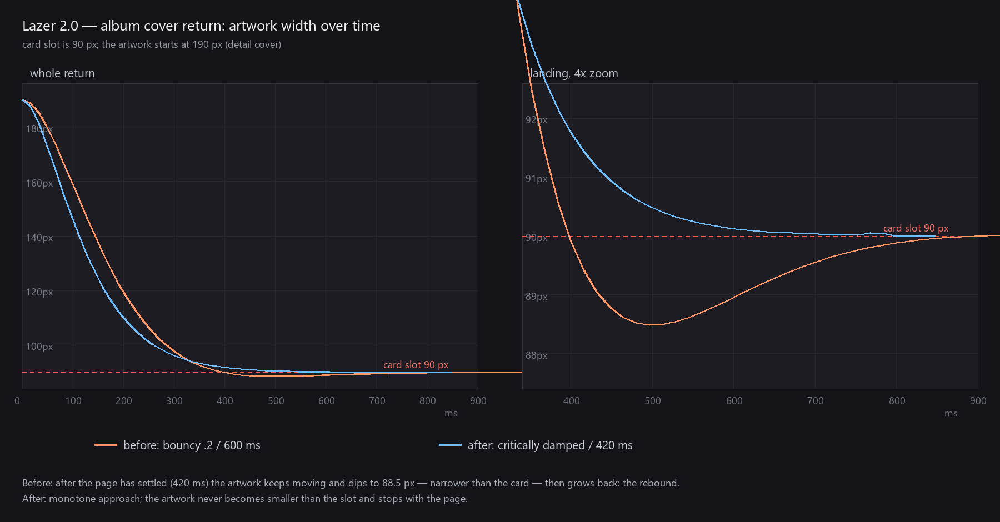

# 封面回程动画审计（2026-11）

- 症状：关闭专辑 / 歌单详情页时，封面飞回货架卡片后会「回弹」一下
- 范围：`lib/widgets/cover_transition.dart` 的回程路径，以及 `RetainedContentSwitcher` 的页面转场
- 方法：静态阅读 + Flutter 3.47.0 逐帧实测（`tester.getRect`）+ 解析弹簧解
- 结论：回程复用了开场那个 `bounce: .2` 的弹簧。回程要收进**固定的卡片槽位**，过冲会让封面比槽位更小、且横向偏移，然后弹回来——这就是「回弹」

---

## 1. 根因

`_coverSpring`（`cover_transition.dart:16`）同时服务两个方向：

```dart
const _coverSpring = AppleSpring(
  duration: AppleSpring.bouncyDuration, // 600 ms
  bounce: .2,
);
```

对 `SpringDescription.withDurationAndBounce`，`bounce = .2` 对应阻尼比 ζ = 0.8，欠阻尼过冲为

```
exp(-πζ / √(1-ζ²)) = exp(-π·0.8 / 0.6) = 1.52%   （行程的 1.52%）
```

开场时封面扩张进详情页，1.52% 的过冲读作「动量」。回程时它落在 90 px 的卡片槽里，同样的 1.52% 变成：

| 边 | 行程 | 过冲 |
| --- | --- | --- |
| 左 | 300 → 20（280 px） | **4.25 px** |
| 右 | 490 → 110（380 px） | **5.76 px** |
| 上 | 160 → 24（136 px） | 2.06 px |
| 下 | 350 → 114（236 px） | 3.58 px |

四条边各自独立弹簧、行程不同，于是过冲量也不同：封面不仅「变小了一点」，还整体向一侧偏移约 5 px，再收回来。

## 2. 逐帧实测

同一 `RetainedContentSwitcher` 场景（卡片 90 px @ `(20,24)`，详情封面 190 px，页面转场 420 ms），`tester.getRect` 采样回程覆盖层：

| 时间 | 修复前（bounce .2 / 600 ms） | 修复后（临界阻尼 / 420 ms） |
| --- | --- | --- |
| 320 ms | (34.97, 39.38, 130.32, 134.73) | (33.51, 36.96, 128.33, 131.79) |
| 480 ms | (15.86, 24.44, **104.38**, 112.96) ← 左右已越过槽位 | (20.00, 24.06, 110.00, 114.07) |
| 512 ms | (15.79, 23.70, 104.28, 112.19) | (20.00, 24.05, 110.00, 114.05) |
| 640 ms | (17.81, 23.19, 107.03, 112.40) ← 往回爬 | (20.00, 24.00, 110.00, 114.00) |
| 覆盖层移除 | **1168 ms** | **864 ms** |

修复前，封面在 480–560 ms 处在槽位内部（宽 88.5 px < 90 px），然后一路涨回 90 px；页面转场 420 ms 就结束了，封面却继续动了约 700 ms。修复后宽度单调收敛，最小值正好 90.0 px，从不小于槽位。



## 3. 回归从哪里引入

| 提交 | 日期 | 变化 | 过冲 |
| --- | --- | --- | --- |
| `0fc60ac` 及更早 | — | `AppleSpring(duration: 420 ms)`，临界阻尼 | 0 px |
| `df4a67e` fix(player): unify player transitions on physical springs | 11-03 | 换成 `AppleSpring.bouncy`（600 ms, bounce .1） | 0.58 px |
| `ea7b5a7` feat: refine app behavior and build artifacts | 11-04 | bounce .1 → **.2** | **5.76 px** |

`bounce` 从 .1 到 .2 看似只加了一点点，但 ζ 从 0.9 降到 0.8，过冲按指数放大 **10 倍**：0.58 px（不可见）→ 5.76 px（明显）。

## 4. 为什么现有测试没抓到

`test/cover_return_transition_test.dart` 已经覆盖了落点精度（< 0.2 px）、滚动接管、重开继承速度、素材复用等，但**没有一条断言检查「是否越过目标再回来」**。落点测试在弹簧振荡结束后测量，回弹已经收敛，所以始终为绿。

## 5. 修复

回程改用专用弹簧，与页面转场同响应：

```dart
const _coverReturnSpring = AppleSpring(
  duration: Duration(milliseconds: 420),
);
```

- `_CoverFlight` / `_CoverPhysics` 增加 `spring` 参数（默认仍是 `_coverSpring`），只有 `_returnToSource` 传入 `_coverReturnSpring`
- 封面与文字飞行共用同一弹簧，因此标题/歌手文字的回程同样不再回弹
- 开场保持 `bounce: .2` 不变
- 与既有规范一致：`docs/now-playing.md` 已明确「revealing 用 bounce .15，hiding 用相同时长、无 bounce」

## 6. 验证

| 项目 | 结果 |
| --- | --- |
| 新增回归测试 `return lands on the card without rebounding inside it` | 回退旧弹簧时失败：**5.757 px**（解析值 5.76 px）；修复后通过 |
| `flutter analyze --no-pub` | No issues found |
| `flutter test --no-pub`（全量） | 通过 |
